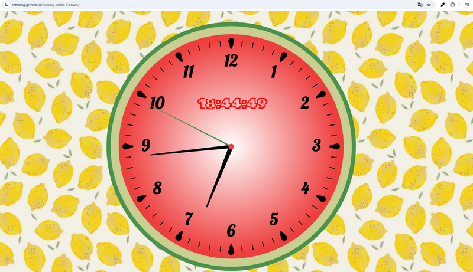

# Watermelon Clock

A browser-based clock implemented in JavaScript using the Canvas API.
The clock combines analog and digital time.
It features the rendering of the clock face, gradients, hour and minute markings, hands,
and a digital display, as well as an adaptive Canvas resizing mechanism that responds to changes in the browser window size.

[Branch with the final version](https://github.com/Intrstng/Analog-clock-Canvas/tree/analog-clock-canvas2-smooth-movement-second-hand)

[Deploy](https://intrstng.github.io/Analog-clock-Canvas/)

## Technologies:
JavaScript (ES6), HTML5, CSS3, Canvas API, HTML Canvas 2D Context
